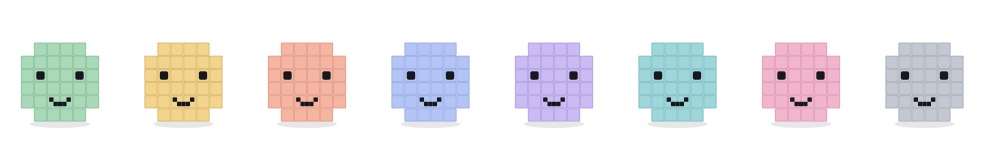
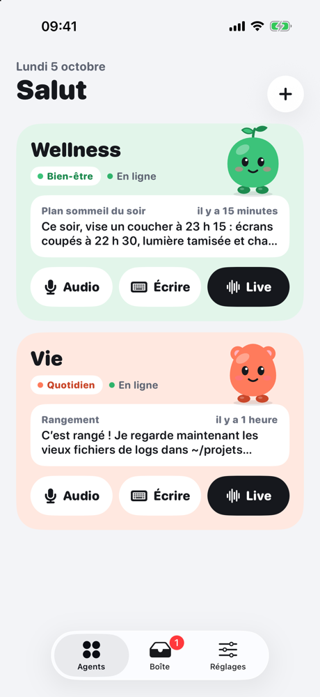
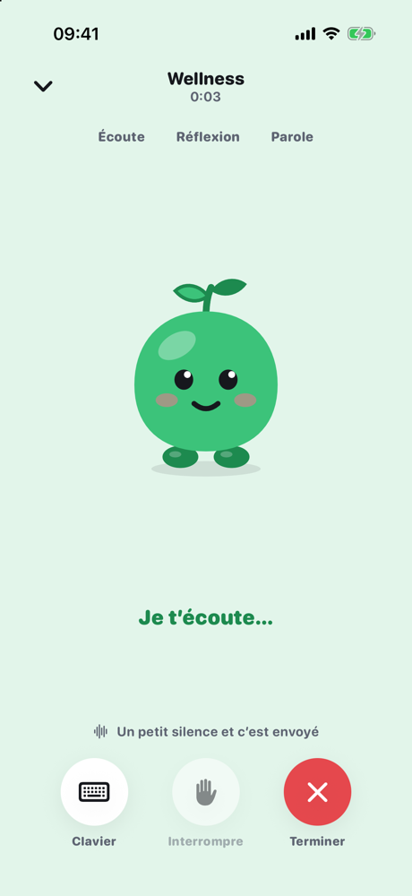
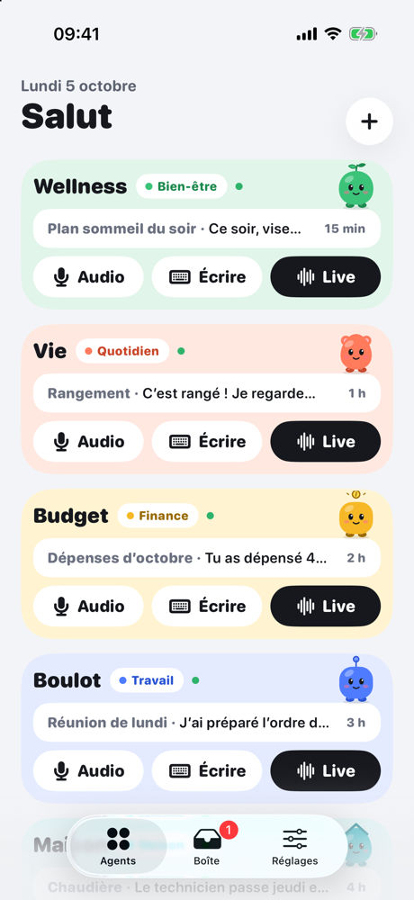
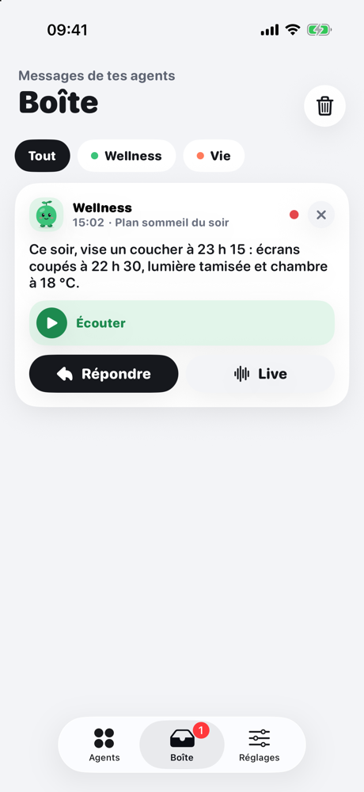
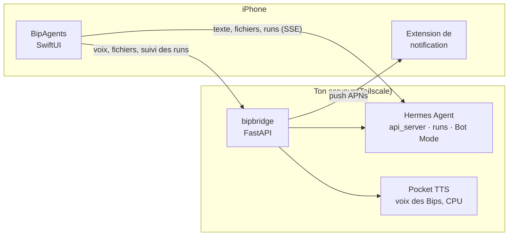

<p align="center"><a href="README.md">🇬🇧 English</a> · 🇫🇷 Français</p>

<p align="center">
  
</p>

<h1 align="center">BipAgents</h1>

<p align="center">
  <b>Parle à tes agents IA auto-hébergés comme à des potes de poche.</b><br>
  App iOS voice-first pour <a href="https://github.com/NousResearch/hermes-agent">Hermes Agent</a>, sur ton propre serveur, via Tailscale.
</p>

<p align="center">
  <a href="https://alexbob0.github.io/BipAgents/play/?lang=fr"></a>
  <a href="https://x.com/Bob_AI_Digger"></a>
  
  
  <a href="LICENSE"></a>
</p>

---

Chaque agent est un **Bip** : une petite mascotte avec sa couleur, sa forme, son humeur et **sa voix**. Wellness veille sur ton sommeil, Vie range tes fichiers, Budget surveille tes dépenses… Tu leur écris, tu leur parles, ou tu lances un **Live** pour discuter à voix haute, mains libres. Ils bossent sur **ton** serveur, et l'app te prévient quand ils ont fini, ou quand ils ont besoin de toi.

<p align="center">
  
  
  
  
</p>

## 🛠️ L'installation en détail en 4 étapes

1. **📱 Sur ton iPhone** : installe **BipAgents** depuis l'App Store *(bientôt)* et
   [**Tailscale**](https://tailscale.com/download), puis connecte-toi à Tailscale.
2. **🖥️ Choisis une machine qui reste allumée**, où vivront tes agents : un Mac ou un PC Linux à la maison, ou un
   [petit serveur loué](docs/vps.fr.md) à partir de 8 € par mois environ. Pas besoin de GPU. Installe Tailscale dessus
   aussi, avec le même compte.
3. **⌨️ Colle ceci dans son terminal**, puis réponds à quelques questions (le nom de tes agents, et le modèle qu'ils
   utilisent : un modèle sur ton réseau, ou une clé OpenRouter) :

   ```bash
   curl -fsSL https://raw.githubusercontent.com/Alexbob0/BipAgents/main/install.sh | bash
   ```

   Sur un PC **Windows 11** (un RTX Spark, un PC de jeu…), dans PowerShell ouvert en administrateur : il prépare WSL2
   et y lance la même installation ([détails](installer/README.fr.md#sur-windows)) :

   ```powershell
   irm https://raw.githubusercontent.com/Alexbob0/BipAgents/main/install.ps1 | iex
   ```

4. **📷 Scanne le QR code** affiché à la fin : dans l'app, **＋ › Scanner le QR code**. Tes Bips te disent bonjour. 👋

Ensuite : `bipagents update` garde tout à jour, `bipagents family add <prénom>` fait de la place pour un proche, et
`bipagents console` ouvre tes agents dans le navigateur d'un ordinateur.

## 🎮 Joue avec les Bips

Les Bips ne sont pas que décoratifs. Dans l'app (et [**dans ton navigateur**](https://alexbob0.github.io/BipAgents/play/?lang=fr)), ils réagissent :

| Geste | Réaction |
|---|---|
| 👆 Toucher | un petit saut, un clin d'œil, une pirouette… au hasard |
| 👆👆👆 Trois touchers rapides, ou frotter vite | ça chatouille ! |
| 🫳 Caresser lentement | ronron, cœurs, joues roses |
| ✊ Appui long puis relâcher | **Boing !** |
| 😵 Trop les embêter | le tournis… puis ils boudent |

Et ils **babillent** : chaque réaction est dite dans leur « Animalese », un charabia mignon synthétisé à la volée, sans modèle ni réseau, avec une hauteur de voix propre à chaque Bip.

<p align="center">
  <a href="https://alexbob0.github.io/BipAgents/play/?lang=fr"><b>→ Ouvrir le terrain de jeu des Bips</b></a>
</p>

## ✨ Ce que sait faire l'app

- 🎙️ **Voix d'abord** : notes vocales (maintenir « Audio » sur la carte d'un agent, relâcher, c'est parti), **Live** mains libres avec interruption à la voix, « Écouter » sous chaque réponse en streaming.
- 🗣️ **Une voix par Bip** : voix mignonnes Kyutai Pocket TTS, **sur CPU, sans GPU** (≈ 50 ms avant le premier son sur un Mac mini M4), conçues directement en français, anglais, espagnol et allemand. Les nombres, symboles, abréviations et noms de marques sont rendus prononçables dans chaque langue. Un GPU ? Branche **ton propre modèle de voix** (Fish Audio Drama 3, Kokoro, Kyutai 1.6B…) pour le Live, les réponses vocales ou la lecture des messages ; le Bip prend le relais quand il est lent ou absent.
- 🖥️ **Le navigateur de chaque agent**, en direct sur ton téléphone : plein écran, paysage, zoom au pincement, prise en main pour te connecter (l'agent attend), et un **coffre** qui remplit les mots de passe sans que l'agent les voie jamais.
- 👨‍👩‍👧 **Toute la famille** : une installation par personne sur le même serveur, chacune dans son compte ; les agents ne s'écrivent (même entre foyers) que là où la personne l'a permis, et partagent des dossiers en lecture seule.
- 🔒 **Ça continue écran verrouillé** : les messages partent en *runs* Hermes. Tu fermes l'app, l'agent finit son travail, et la réponse arrive en notification, avec l'avatar du Bip et le vrai texte.
- ✅ **Accords depuis l'écran verrouillé** : « Wellness veut lancer `pip install openpyxl` » → Une fois / Cette session / Refuser, sans ouvrir l'app.
- ❓ **L'agent peut te poser une question** (outil `clarify`) : une carte avec un bouton par choix, comme sur Hermes Desktop.
- 🤝 **Les agents se parlent** : Vie peut consulter Wellness ; l'échange se replie en une ligne dans la conversation.
- 📬 **La Boîte** : rapports des tâches planifiées (cron), réponses arrivées pendant ton absence, à écouter ou à relancer en Live.
- 📎 **Tout type de fichier** : photos, PDF, Excel, scans… et les fichiers produits par l'agent (audio, documents) s'ouvrent dans l'app.
- 🌍 **En français, anglais, espagnol et allemand** : l'app suit la langue de l'iPhone, et chaque agent a sa propre langue (reconnaissance vocale et voix).
- 💻 **Sur ton ordinateur aussi** : `bipagents console` donne un lien qui ouvre tes agents, leurs conversations et la boîte de réception dans un navigateur, sans qu'aucune clé Hermes n'y arrive.
- 🔗 Liens cliquables avec favicons, outils repliés, brouillons gardés par conversation, séparateurs de jours.

<details>
<summary><b>📸 Plus de captures</b></summary>
<br>
<p align="center">
  
  
  
</p>
</details>

## ☁️ Ton agent à toi sur un petit serveur, à partir de 8 € par mois

Pas de machine à la maison ? Un **petit VPS** fait tourner Hermes, le bridge et les voix des Bips sur son processeur
(2 vCPU et 4 Go dès ≈ 8 € par mois ; 4 vCPU et 8 Go, avec le navigateur visible de chaque agent, ≈ 15 €), et le modèle
vient d'**OpenRouter**, payé à l'usage. Tu as un agent toujours disponible, dans ta poche, avec une voix.

- **Ce qui reste à toi** : les conversations, la mémoire des agents, tes fichiers et le coffre sont sur ton serveur, pas
  sur une plateforme. Tu changes de modèle quand tu veux, sans rien exporter.
- **Ce qui sort** : chaque message part au modèle choisi, pour qu'il y réponde. Choisis des fournisseurs qui ne gardent
  rien dans les réglages de confidentialité d'OpenRouter (zero data retention), ou un modèle qui tourne chez toi, joint
  par Tailscale.
- **Ce que tu n'as pas à faire** : ouvrir des ports. Tout passe par Tailscale ; même SSH peut être fermé.

Pas à pas, d'un cloud-init tout prêt jusqu'au QR code : [**BipAgents sur un serveur loué**](docs/vps.fr.md).

## 🧩 Comment ça marche



- **L'app** parle directement à l'api_server Hermes (sessions, runs, accords, questions) et au **bridge** pour tout le reste.
- **Le bridge** (`bridge/`, Python) prépare et fait synthétiser les voix, sert les fichiers, relaie les runs pour qu'aucun événement ne se perde, surveille les tâches planifiées et envoie les notifications push.
- **Pocket TTS** (`pocket/`) donne leur voix aux Bips, sur le CPU de la même machine.
- Tout reste chez toi : aucun cloud tiers à part Apple pour les push. Aucun secret dans ce dépôt ; les clés sont saisies dans l'app (Trousseau) ou dans la config du bridge sur le serveur.

## 🚀 Démarrer

**Juste pour voir**, sans serveur : ouvre `BipAgents.xcodeproj`, schéma BipAgents → Arguments → `-demo`. Ajoute `-screen conversation`, `-screen call`, `-tab inbox` ou `-demoAgents 5` pour arriver directement sur un écran.

**Pour de vrai** : un **Mac mini**, un **VPS** ou un serveur Linux suffit, sans GPU ; [Hermes Agent](https://github.com/NousResearch/hermes-agent) vient avec l'installateur si tu ne l'as pas. Pour tout faire à la main : [**Héberger BipAgents chez soi**](docs/self-hosting.fr.md). Sans machine à la maison : [**BipAgents sur un serveur loué**](docs/vps.fr.md).

**La commande d'installation** (étape 3) tourne dans ton propre compte, sans sudo. Elle trouve ou installe Hermes (ou garde le tien tel quel), cherche un modèle sur ton réseau ou prend une clé d'API, met
en place le bridge, les voix des Bips, le navigateur et le bac à sable de chaque agent (podman), publie tout sur ton
tailnet et finit par un QR code à scanner dans l'app. **Une commande pour mettre à jour** : `bipagents update` relance
seulement ce qui a changé, applique les nouveaux réglages, propose de mettre à jour les autres installations de la
famille avec un seul sudo, et peut le faire chaque nuit ([détails](installer/README.fr.md#mettre-bipagents-à-jour)).

**Toute la famille sur un serveur** : une installation par personne, chacune dans son compte, préparée par l'administrateur avec `bipagents family add <prénom>` — [qui lance quoi, depuis quel compte](installer/README.fr.md#plusieurs-personnes-sur-une-machine).

> 🎙️ **Bonus** : avec un GPU, ton propre modèle de voix (Fish Audio Drama 3, Kokoro, Kyutai…) peut parler à la place des Bips pour le Live, les réponses vocales ou la lecture des messages. Facultatif, cf. la fin du guide.

## 🧱 Ce que BipAgents ajoute à Hermes

[Hermes Agent](https://github.com/NousResearch/hermes-agent) fait le travail de fond : modèles, outils, mémoire,
skills, routines. BipAgents en fait quelque chose qu'on emporte avec soi et qu'on partage à la maison :

| | Hermes seul | Avec BipAgents |
|---|---|---|
| Lui parler | terminal, messageries, interface web | une app iPhone pensée pour la voix : notes vocales, Live mains libres, écoute de chaque réponse |
| Voix | aucune | une voix par agent sur CPU (4 langues), ou ton propre modèle sur GPU |
| Hors de l'app | | notifications avec la réponse, accords et questions depuis l'écran verrouillé |
| Installation | l'installateur de Hermes, puis la config à la main | une commande : Hermes, bridge, voix, navigateurs, bacs à sable, Tailscale, QR code |
| Mise à jour | `hermes update` | `bipagents update` : ce qui a changé, les installations de la famille avec un seul sudo, chaque nuit |
| Navigation | un outil navigateur | le Chrome de chaque agent, regardé et pris en main depuis le téléphone, avec un coffre |
| Plusieurs agents | des profils | une mascotte, une voix et des réglages par agent ; un espace à lui pour l'agent qui détient des secrets |
| Plusieurs personnes | | une installation isolée par personne sur le même serveur ; des foyers reliés volontairement |
| Injection de consignes | des accords | accords toujours demandés, agents prévenus que ce qu'ils lisent est une donnée, échanges entre agents limités à une discussion, agent en pause quand tu as son navigateur en main |

## 🩹 Les patches de Hermes encore nécessaires

Quelques changements dont BipAgents a besoin ne sont pas encore dans Hermes. L'installateur les applique (et
`bipagents hermes-update` les vérifie avant de mettre Hermes à jour) ; chacun est proposé au projet. Détails dans
[`hermes/patches/`](hermes/patches/README.md).

| Patch | Pourquoi | En amont |
|---|---|---|
| 0001 `clarify` dans l'API des runs | l'agent peut te poser une question à choix depuis l'app | proposé dans #116259 |
| 0004 images gardées dans la conversation | une question de suivi sur une photo voit encore la photo | remplacé par #139873 (ouverte) |
| 0005 remplissage du coffre après redémarrage du navigateur | les connexions marchent encore quand le navigateur de l'agent a été fermé puis rouvert | #136660 |
| 0006 la réponse d'un autre agent revient dans l'app | quand un agent en consulte un autre, sa réponse arrive dans ta conversation | local |

<details>
<summary><b>🗂️ Le dépôt</b></summary>

- `App/` — l'app SwiftUI (iOS 18+, Swift 6).
  - `Design/` — thème, catégories, mascottes vectorielles (`MascotView`), interactions (`InteractiveMascot`), babillage (`BipBabble`), voix des agents.
  - `Model/` — `AgentStore` (agents dans l'App Group, clés dans le Trousseau), `BridgeClient`, `Router`.
  - `Features/` — Agents, Sessions, Conversation, Live, Boîte, Réglages, Diagnostics, notifications.
- `NotificationService/` — extension qui met le texte complet, l'avatar du Bip et l'audio dans les notifications.
- `Packages/HermesKit` — client de l'api_server Hermes (SSE, sessions, runs, accords, `clarify`, pièces jointes).
- `Packages/VoiceKit` — capture, transcription sur l'iPhone, TTS en flux PCM, interruption à la voix.
- `bridge/` — le service Python côté serveur ([README](bridge/README.fr.md)).
- `pocket/` — le serveur Pocket TTS des voix des Bips ([README](pocket/README.fr.md)).
- `voices/` — les voix des Bips ([README](voices/README.fr.md)).
- `installer/` — l'installateur et `bipagents update` ([README](installer/README.fr.md)) ; `browser/` — le navigateur visible des agents ([README](browser/README.md)) ; `hermes/patches/` — les patches de Hermes ([README](hermes/patches/README.md)) ; `tts/drama3/` — une recette pour Fish Audio Drama 3 comme modèle de voix.
- `docs/` — notes d'API ([`clarify`](docs/hermes-clarify-api.fr.md), [fichiers](docs/file-uploads.fr.md)), captures, [terrain de jeu](docs/play/index.html) et bannière (`node docs/tools/banner.mjs` la régénère).
- [`CONTRIBUTING.md`](CONTRIBUTING.md) — comment contribuer ; [`SECURITY.md`](SECURITY.md) — signaler une faille, et comment BipAgents tient les agents en respect.

</details>

## 💬 Qui est derrière

Un projet perso de **Bob**, qui creuse l'IA au quotidien : agents, voix, auto-hébergement.
Les coulisses, les galères et les prochains Bips sont sur X : **[@Bob_AI_Digger](https://x.com/Bob_AI_Digger)** 👋

Construit avec [Hermes Agent](https://github.com/NousResearch/hermes-agent) de Nous Research, les voix [Kyutai](https://kyutai.org), et beaucoup de sessions avec Claude.

<p align="center"><sub>MIT · Fait avec ♥ et des Bips</sub></p>
