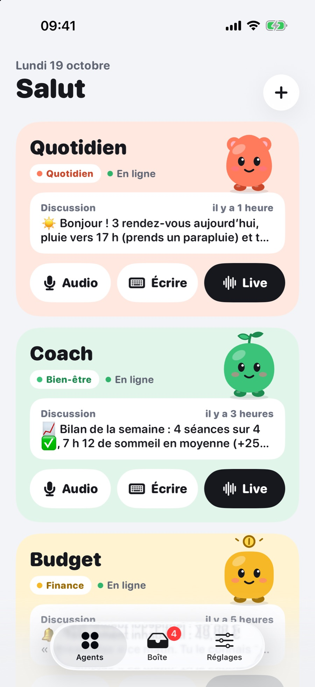
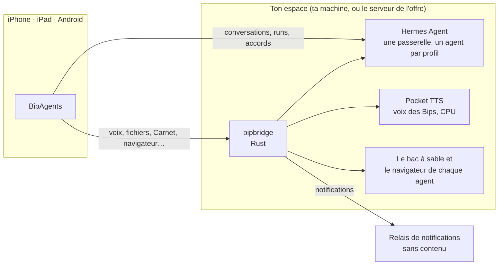

<p align="center"><a href="README.md">🇬🇧 English</a> · 🇫🇷 Français</p>

<p align="center">
  
</p>

<h1 align="center">BipAgents</h1>

<p align="center">
  <b>Des agents IA qui agissent pour toi, comme des potes de poche.</b><br>
  Apps pour iPhone, iPad et Android, construites sur <a href="https://github.com/NousResearch/hermes-agent">Hermes Agent</a> de Nous Research.
</p>

<p align="center">
  <a href="https://bipagents.com/fr/"></a>
  <a href="https://alexbob0.github.io/BipAgents/play/?lang=fr"></a>
  <a href="https://x.com/Bob_AI_Digger"></a>
  <a href="LICENSE"></a>
</p>

---

Chaque agent est un **Bip** : une petite mascotte avec sa couleur, sa forme, son humeur et **sa voix**. L'un veille
sur ta journée, un autre sur ton sommeil, un autre sur ton budget… Tu leur écris, tu leur parles, ou tu les appelles
en **Live**, mains libres. Ils lisent tes mails, tiennent ton agenda, naviguent sur le web dans un vrai navigateur que
tu peux regarder, et **te demandent avant d'agir**.

<p align="center">
  
  
  
  
</p>

## Deux façons d'utiliser BipAgents

### ☁️ Tout compris, par Kerfy Studio — *bientôt*

Rien à installer : tu télécharges l'app, tu choisis une formule, tes Bips te disent bonjour. Chaque personne a **son
propre espace privé sur un serveur dans l'Union européenne**, entretenu par Kerfy Studio (mises à jour, sauvegardes
chiffrées toutes les heures, assistance).

- **Solo**, **Duo** ou **Famille** (jusqu'à 6 personnes, chacune avec son espace, ses agents et sa vie privée).
- **Crédit IA inclus chaque mois**, partagé par toute la formule ; l'app l'affiche en nombre estimé de messages (une
  tâche dans le navigateur en utilise plus qu'un simple message). Le crédit non utilisé est reporté d'un mois.
- **Moins cher sur le site** que sur l'App Store et Google Play ; une semaine offerte peut ouvrir la formule.

**Pas encore en vente** : les apps sont en test (TestFlight, test interne Google Play) et le paiement sur le site est
fermé. Prix et détails : [**bipagents.com**](https://bipagents.com/fr/) · les conditions de l'offre :
[kerfystudio.com](https://kerfystudio.com/offer/).

### 🖥️ Gratuit, sur ton ordinateur ou ton serveur

Si tu fais tourner [Hermes Agent](https://github.com/NousResearch/hermes-agent) — ou si tu veux le faire —, BipAgents
s'installe à côté, gratuitement, sur un Mac, un PC Linux, un [petit serveur loué](docs/vps.fr.md) (à partir de
8 € par mois environ) ou Windows 11 (via WSL2). Pas besoin de GPU. Tes agents, leur mémoire et tes fichiers restent
sur ta machine.

1. **Sur une machine qui reste allumée**, installe [Tailscale](https://tailscale.com/download), puis colle ceci dans
   son terminal et réponds à quelques questions (le nom de tes agents, et le modèle : un modèle sur ton réseau, ou une
   clé d'API) :

   ```bash
   curl -fsSL https://raw.githubusercontent.com/Alexbob0/BipAgents/main/install.sh | bash
   ```

   Sur **Windows 11**, dans PowerShell ouvert en administrateur (il prépare WSL2 et y lance la même installation) :

   ```powershell
   irm https://raw.githubusercontent.com/Alexbob0/BipAgents/main/install.ps1 | iex
   ```

   **🧩 Tu as déjà Hermes Agent ?** La même commande, sur sa machine : elle se branche dessus **sans toucher à ton
   modèle, tes outils, tes plateformes ni tes agents**, te demande lesquels montrer et affiche tout ce qu'elle va
   changer avant de commencer ([détails](installer/README.fr.md#si-tu-as-déjà-hermes)).

2. **Scanne le QR code** affiché à la fin dans l'app (**＋ › Scanner le QR code**), avec Tailscale sur ton téléphone
   aussi. Les apps arrivent bientôt sur les stores ; en attendant, `bipagents console` ouvre tes agents dans le
   navigateur d'un ordinateur.

Ensuite : `bipagents update` garde tout à jour (chaque nuit si tu veux), `bipagents family add <prénom>` fait de la
place pour un proche sur la même machine, `bipagents export --moving` emmène tes agents, mémoire comprise, sur une
autre machine. Tout est dans le [guide de l'installateur](installer/README.fr.md) ; à la main :
[auto-hébergement](docs/self-hosting.fr.md).

## ✨ Ce que font tes Bips

- 🎙️ **La voix d'abord** : notes vocales, appels **Live** que tu interromps en parlant, et « Écouter » sous chaque
  réponse. Chaque Bip a sa voix, en français, anglais, espagnol et allemand, produite sur ton téléphone ou sur le
  processeur du serveur.
- 📒 **Le Carnet** : tes agents y rangent ce qui compte — les personnes, les sujets, les tâches liées aux rappels de
  ton téléphone, des **fiches** (achats et leur garantie, abonnements, contrats, papiers, réservations) et des pages
  **voyage**. Les anciens dossiers et boîtes mail vont dans les **Archives**, consultées au besoin. Des pages Markdown
  simples, qui s'ouvrent dans Obsidian.
- 📬 **Tes outils de tous les jours** : mail, agenda (celui du téléphone, ou de ta boîte mail), notes, rappels,
  contacts, météo, et Santé d'Apple ou Health Connect par catégorie — chacun seulement pour les agents que tu choisis.
- 🖥️ **Un vrai navigateur par agent** : tu le vois naviguer dans la conversation, et tu **prends la main** avec
  Face ID (ou le verrouillage de ton téléphone) pour te connecter. Son **coffre** remplit les mots de passe et crée
  des comptes sans que l'agent les voie jamais ; une carte de paiement (là où les cartes sont activées) n'y sert
  qu'après ton accord pour chaque paiement.
- ✅ **Ton accord avant d'agir**, en mots simples (« Daily veut modifier ton agenda »), depuis l'écran verrouillé ; et
  l'agent peut te poser une question avec un bouton par choix.
- 🧩 **Des tâches de fond** pour les longs travaux, avec le coût affiché avant et après, et une notification à la fin.
- 📊 **Des pages et mini-apps** dans les réponses — graphiques, suivis, **cartes interactives** avec « Ouvrir dans
  Plans » — et des **podcasts** lus par deux Bips.
- 🔒 **Chaque agent dans son bac à sable** : ses propres fichiers, des dossiers qu'il partage avec les agents que tu
  choisis (en lecture seule pour eux), et seulement les sites que tu as autorisés.
- 👨‍👩‍👧 **Toute la famille** : un espace privé par personne ; les agents de tes proches ne se parlent que là où tu l'as
  permis. Des agents rangés en groupes sur l'accueil (Perso, Pro, Famille, ou le tien).
- 💻 **Sur un ordinateur aussi** : la console web ouvre tes agents, leurs conversations et la Boîte dans un
  navigateur.
- 🌍 En français, anglais, espagnol et allemand ; chaque agent parle et écoute dans sa langue.

## 🎮 Joue avec les Bips

Dans l'app (et [**dans ton navigateur**](https://alexbob0.github.io/BipAgents/play/?lang=fr)), ils réagissent : un
toucher pour un saut, frotter pour les chatouiller, caresser lentement pour des cœurs, un appui long pour un
**Boing !**, trop les embêter et ils boudent. Chaque réaction est babillée dans leur « Animalese », synthétisé à la
volée, sans modèle ni réseau.

## 🧩 Comment ça marche



- **[Hermes Agent](https://github.com/NousResearch/hermes-agent)** réfléchit : le modèle que tu as choisi, les
  outils, la mémoire, les compétences, les routines.
- **Le bridge** ([`bridge-rs/`](bridge-rs/), un seul programme en Rust ; [README](bridge/README.fr.md)) ajoute tout le
  reste : voix, fichiers, Carnet, connecteurs, navigateurs et coffre des agents, accords, tâches de fond, pages,
  sauvegardes, console web. Ses binaires sont publiés en pré-versions GitHub `bridge-<clé>`, que les installations
  téléchargent.
- **Pocket TTS** ([`pocket/`](pocket/README.fr.md)) donne leur voix aux Bips, sur le processeur du serveur.
- **Le relais de notifications** ([`relay/`](relay/README.fr.md)) transmet les notifications à Apple et Google sans
  leur texte : l'app va le chercher sur ton propre bridge.
- À la maison, les apps rejoignent ta machine par **Tailscale** (ou par une porte HTTPS épinglée sur ton réseau
  local) ; rien n'est ouvert sur Internet.

Ce qui sort de ton espace : chaque message part au modèle d'IA que tu as choisi, pour qu'il y réponde ; les services
qu'un agent utilise pour toi (recherche web, cartes, météo) voient ses requêtes. Détails :
[ce que les apps envoient, et à qui](docs/app-data.fr.md) · [la comparaison avec ChatGPT et les
autres](docs/privacy-compare.fr.md).

## 🧱 Ce que BipAgents ajoute à Hermes

| | Hermes seul | Avec BipAgents |
|---|---|---|
| Lui parler | terminal, plateformes de discussion, interface web | apps iPhone, iPad et Android : notes vocales, appels Live, console web |
| Voix | aucune | une voix par agent, sur le téléphone ou le CPU (4 langues), ou ton propre modèle de voix |
| Hors de l'app | | notifications avec la réponse, accords et questions depuis l'écran verrouillé |
| Ce qu'il retient pour toi | mémoire, compétences | un Carnet lisible : personnes, tâches, fiches, voyages, archives |
| Naviguer | un outil de navigation | le Chrome de chaque agent, suivi dans la conversation et repris depuis le téléphone, avec un coffre |
| Installer, mettre à jour | l'installateur d'Hermes, puis la config à la main | une commande ; `bipagents update` (les installations de la famille aussi, chaque nuit) |
| Plusieurs personnes | | un espace isolé par personne ; des foyers reliés exprès |
| Injection de prompt | accords | accords toujours demandés, ce que lisent les agents traité comme des données, pairs limités à une discussion, bacs à sable sans tes dossiers ni ton réseau |

Quelques changements dont BipAgents a besoin ne sont pas encore dans Hermes : l'installateur les applique, et chacun
est proposé en amont ([`hermes/patches/`](hermes/patches/README.md)).

| Patch | Pourquoi | En amont |
|---|---|---|
| 0001 `clarify` dans l'API Runs | l'agent peut te poser une question à choix depuis l'app | proposé à #116259 |
| 0004 images gardées dans la conversation | une question de suite sur une photo voit encore la photo | remplacé par #139873 (ouvert) |
| 0005 le coffre remplit après un redémarrage du navigateur | les connexions marchent encore quand le navigateur de l'agent a été fermé puis rouvert | #136660 |
| 0006 la réponse d'un pair revient dans l'app | quand un agent en consulte un autre, sa réponse arrive dans ta conversation | local |
| 0007 naviguer seulement dans le navigateur visible | les agents qui ont leur navigateur s'en servent, et gardent le coffre | local |

## 🗂️ Le dépôt

- [`bridge-rs/`](bridge-rs/) — le bridge, en Rust ; [`bridge/`](bridge/README.fr.md) — son exemple de config, ses
  fichiers de service, sa suite de tests boîte noire et ses outils.
- [`installer/`](installer/README.fr.md), `install.sh`, `install.ps1` — l'installateur et la commande `bipagents`.
- [`browser/`](browser/README.fr.md) — le navigateur visible des agents ; [`pocket/`](pocket/README.fr.md) et
  [`voices/`](voices/README.fr.md) — les voix des Bips ; [`relay/`](relay/README.fr.md) — le relais de notifications ;
  [`hermes/patches/`](hermes/patches/README.md) — les patchs Hermes ; [`tts/drama3/`](tts/drama3/README.md) — une
  recette pour faire tourner ton propre modèle de voix.
- [`site/`](site/README.md) — bipagents.com et kerfystudio.com ; [`docs/`](docs/) — guides et notes
  ([auto-hébergement](docs/self-hosting.fr.md), [serveur loué](docs/vps.fr.md),
  [ce que les apps envoient](docs/app-data.fr.md), les
  [textes légaux](docs/legal/)).
- Les apps (iPhone, iPad, Android, natives en SwiftUI et Kotlin/Compose) appartiennent à Kerfy Studio et leur code est
  privé. Publiés ici pour que chacun puisse vérifier leurs promesses : le chiffrement de bout en bout du compte,
  identique dans les deux apps (`App/Features/Account/AccountCrypto.swift`, `android/…/account/AccountCrypto.kt`, avec
  ses vecteurs de test), et les scénarios de la démo (`App/Resources/Demo/`). Le **guichet**, le serveur de l'offre
  (formules, serveurs, sauvegardes), est privé lui aussi.
- [`CONTRIBUTING.md`](CONTRIBUTING.md) — comment aider ; [`SECURITY.md`](SECURITY.md) — comment signaler une faille.

## 📜 Licence

Le **code publié ici** est un logiciel libre sous [licence MIT](LICENSE). Les **Bips eux-mêmes** (leurs dessins,
l'icône de l'app, leur babil et leurs voix, les enregistrements et les captures d'écran) ne le sont pas :
[LICENSE-ASSETS](LICENSE-ASSETS) permet de les montrer et de compiler BipAgents avec eux, pas de les mettre dans une
autre app. Contribuer : voir les [conditions de contribution](CONTRIBUTING.md#contribution-terms).

## 💬 Qui est derrière

BipAgents est édité par **Kerfy Studio**, une SAS française ([kerfystudio.com](https://kerfystudio.com/) :
[confidentialité](https://kerfystudio.com/privacy/), [conditions](https://kerfystudio.com/terms/),
[usage acceptable](https://kerfystudio.com/acceptable-use/), [mentions légales](https://kerfystudio.com/mentions-legales/)).
C'est parti du projet perso de **Bob** ; les coulisses et les prochains Bips sur X :
**[@Bob_AI_Digger](https://x.com/Bob_AI_Digger)**. Contact : support@bipagents.com · privacy@bipagents.com ·
security@bipagents.com · abuse@bipagents.com.

Construit sur [Hermes Agent](https://github.com/NousResearch/hermes-agent) de Nous Research (BipAgents en est
indépendant), avec les voix des Bips faites avec Pocket TTS de [Kyutai](https://kyutai.org), et beaucoup de sessions
avec Claude.

<p align="center"><sub>Code sous MIT · les Bips sont réservés (LICENSE-ASSETS) · Fait avec ♥ et des Bips</sub></p>
