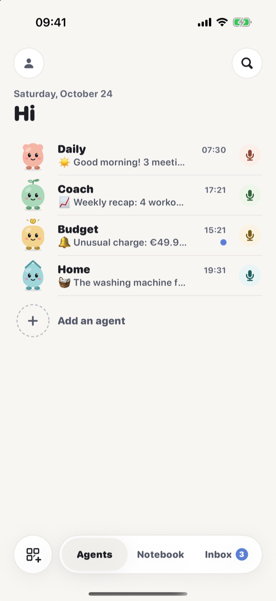
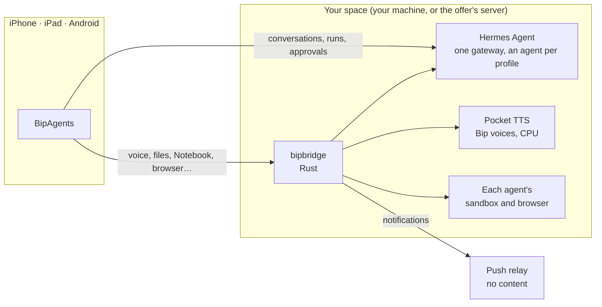

<p align="center">🇬🇧 English · <a href="README.fr.md">🇫🇷 Français</a></p>

<p align="center">
  
</p>

<h1 align="center">BipAgents</h1>

<p align="center">
  <b>AI agents that act for you, like pocket-sized buddies.</b><br>
  Apps for iPhone, iPad and Android, built on <a href="https://github.com/NousResearch/hermes-agent">Hermes Agent</a> by Nous Research.
</p>

<p align="center">
  <a href="https://bipagents.com"></a>
  <a href="https://alexbob0.github.io/BipAgents/play/"></a>
  <a href="https://x.com/Bob_AI_Digger"></a>
  <a href="LICENSE"></a>
</p>

---

Every agent is a **Bip**: a little mascot with its own color, shape, mood and **voice**. One looks after your day,
another your sleep, another your budget… Text them, talk to them, or call them in **Live**, hands-free. They read
your mail, keep your calendar, browse the web in a real browser you can watch, and **ask you before they act**.

<p align="center">
  
  
  
  
</p>

## Two ways to use BipAgents

### ☁️ All included, by Kerfy Studio — *coming soon*

Nothing to install: download the app, pick a plan, your Bips say hello. Each person gets **a private space of their
own on a server in the European Union**, looked after by Kerfy Studio (updates, hourly encrypted backups, support).

- **Solo**, **Duo** or **Famille** (up to 6 people, each with their own space, agents and privacy).
- **AI credit included every month**, shared by everyone in the plan; the app shows it as an estimated number of
  messages (a task in the browser uses more than a simple message). Unused credit carries over a month.
- **Lower prices on the website** than in the App Store and Google Play; a free week may start a plan.

It is **not on sale yet**: the apps are in testing (TestFlight, Google Play internal testing) and the web checkout is
off. Prices and details: [**bipagents.com**](https://bipagents.com) · the offer's terms:
[kerfystudio.com](https://kerfystudio.com/en/offer/).

### 🖥️ Free, on your own computer or server

If you run [Hermes Agent](https://github.com/NousResearch/hermes-agent) — or want to — BipAgents installs next to it,
for free, on a Mac, a Linux PC, a [small rented server](docs/vps.md) (from ≈ €8 a month) or Windows 11 (through
WSL2). No GPU needed. Your agents, their memory and your files stay on your machine.

1. **On a machine that stays on**, install [Tailscale](https://tailscale.com/download), then paste this in its
   terminal and answer a few questions (your agents' names, and the model: one on your network, or an API key):

   ```bash
   curl -fsSL https://raw.githubusercontent.com/Alexbob0/BipAgents/main/install.sh | bash
   ```

   On **Windows 11**, in PowerShell opened as administrator (it sets up WSL2 and runs the same install inside):

   ```powershell
   irm https://raw.githubusercontent.com/Alexbob0/BipAgents/main/install.ps1 | iex
   ```

   **🧩 Already running Hermes Agent?** Same command, on its machine: it plugs into it **without touching your model,
   tools, platforms or agents**, asks which agents to show, and lists everything it will change before it starts
   ([details](installer/README.md#if-you-already-have-hermes)).

2. **Scan the QR code** it shows at the end in the app (**＋ › Scan QR code**), with Tailscale on your phone too.
   The apps are coming soon to the stores; until then, `bipagents console` opens your agents in a computer's browser.

Then: `bipagents update` keeps everything up to date (every night if you like), `bipagents family add <name>` makes
room for someone else on the same machine, `bipagents export --moving` takes your agents, memory and all, to another
machine. All of it in the [installer's guide](installer/README.md); by hand: [self-hosting](docs/self-hosting.md).

## ✨ What your Bips do

- 🎙️ **Voice first**: voice notes, **Live** calls you interrupt just by talking, and « Listen » under every reply.
  Each Bip has its own voice, in English, French, Spanish and German, made on your phone or on the server's CPU.
- 📒 **The Notebook**: your agents file what matters — people, subjects, tasks linked to your phone's reminders,
  **records** (purchases and their warranty, subscriptions, contracts, papers, bookings) and **trip** pages. Old
  folders and mailboxes go into **Archives**, searched when needed. Plain Markdown pages that open in Obsidian.
- 📬 **Your everyday tools**: mail, calendar (the phone's, or your mailbox's), notes, reminders, contacts, weather,
  and Apple Health or Health Connect by category — each one only for the agents you pick.
- 🖥️ **A real browser for each agent**: you see it browse right in the conversation, and **take over** with Face ID
  (or your phone's lock) to sign in. Its **vault** fills passwords and creates logins without the agent ever seeing
  them; a payment card in it (where cards are turned on) is used only after you approve each payment.
- ✅ **Approvals before actions**, in plain words (« Daily wants to change your calendar »), from the lock screen; and
  the agent can ask you a question with one button per choice.
- 🧩 **Background tasks** for long work, with the cost shown before and after, and a notification when done.
- 📊 **Pages and mini apps** right in the replies — charts, trackers, **interactive maps** with « Open in Maps » —
  and **podcasts** read by two Bips.
- 🔒 **Each agent in its own sandbox**: its own files, folders it shares with the agents you choose (read-only for
  them), and only the websites you allowed.
- 👨‍👩‍👧 **The whole family**: one private space per person; relatives' agents talk to each other only along links you
  turned on. Agents sorted into groups on the home screen (Personal, Pro, Family, or your own).
- 💻 **On a computer too**: the web console opens your agents, their conversations and the Inbox in a browser.
- 🌍 In English, French, Spanish and German; agents speak and listen in their own language.

## 🎮 Play with the Bips

In the app (and [**in your browser**](https://alexbob0.github.io/BipAgents/play/)), they react: tap for a hop, rub
for a tickle, stroke slowly for hearts, long-press for a **Boing!**, pester them and they sulk. Every reaction is
babbled in their own « Animalese », synthesized on the fly, with no model and no network.

## 🧩 How it works



- **[Hermes Agent](https://github.com/NousResearch/hermes-agent)** does the thinking: the model you chose, tools,
  memory, skills, routines.
- **The bridge** ([`bridge-rs/`](bridge-rs/), one Rust program; [README](bridge/README.md)) adds everything else: voices,
  files, the Notebook, connectors, the agents' browsers and vault, approvals, background tasks, pages, backups, the web
  console. Its binaries are published as GitHub pre-releases `bridge-<key>`, which installs fetch.
- **Pocket TTS** ([`pocket/`](pocket/README.md)) gives the Bips their voices on the server's CPU.
- **The push relay** ([`relay/`](relay/README.md)) forwards notifications to Apple and Google without their text: the
  app fetches it from your own bridge.
- At home, the apps reach your machine through **Tailscale** (or a pinned HTTPS door on your local network); nothing
  is opened on the Internet.

What leaves your space: each message goes to the AI model you chose, to be answered; the services an agent uses for
you (web search, maps, weather) see its requests. Details: [what the apps send, and to whom](docs/app-data.md) ·
[how this compares with ChatGPT and others](docs/privacy-compare.md).

## 🧱 What BipAgents adds to Hermes

| | Hermes alone | With BipAgents |
|---|---|---|
| Talking to it | terminal, chat platforms, web UI | apps for iPhone, iPad and Android: voice notes, Live calls, a web console |
| Voices | none | a voice per agent, on the phone or the CPU (4 languages), or your own voice model |
| Away from the app | | notifications with the reply, approvals and questions from the lock screen |
| What it remembers for you | memory, skills | a Notebook you can read: people, tasks, records, trips, archives |
| Browsing | a browser tool | each agent's own Chrome, watched in the conversation and taken over from the phone, with a vault |
| Installing, updating | Hermes' installer, then config by hand | one command; `bipagents update` (the family's installs too, nightly) |
| Several people | | one isolated space per person; households linked on purpose |
| Prompt injection | approvals | approvals always asked, what agents read treated as data, peers limited to a chat, sandboxes without your folders or network |

A few changes BipAgents needs aren't in Hermes yet: the installer applies them, and each one is offered upstream
([`hermes/patches/`](hermes/patches/README.md)).

| Patch | Why | Upstream |
|---|---|---|
| 0001 `clarify` in the Runs API | the agent can ask you a question with choices from the app | offered to #116259 |
| 0004 images kept in the conversation | a follow-up question about a photo still sees the photo | replaced by #139873 (open) |
| 0005 vault fills after the browser restarted | logins keep working when the agent's browser was closed and reopened | #136660 |
| 0006 a peer's reply comes back to the app | when an agent asks another one, its answer reaches your conversation | local |
| 0007 browsing only in the visible browser | agents with their own browser use it, and keep the vault | local |

## 🗂️ The repository

- [`bridge-rs/`](bridge-rs/) — the bridge, in Rust; [`bridge/`](bridge/README.md) — its config example, service files,
  black-box test suite and tools.
- [`installer/`](installer/README.md), `install.sh`, `install.ps1` — the installer and the `bipagents` command.
- [`browser/`](browser/README.md) — the agents' visible browser; [`pocket/`](pocket/README.md) and
  [`voices/`](voices/README.md) — the Bips' voices; [`relay/`](relay/README.md) — the push relay;
  [`hermes/patches/`](hermes/patches/README.md) — the Hermes patches; [`tts/drama3/`](tts/drama3/README.md) — a recipe
  for running your own voice model.
- [`site/`](site/README.md) — bipagents.com and kerfystudio.com; [`docs/`](docs/) — guides and notes
  ([self-hosting](docs/self-hosting.md), [rented server](docs/vps.md), [what the apps send](docs/app-data.md),
  [space encryption](docs/space-encryption.md), the [legal texts](docs/legal/)).
- The apps (iPhone, iPad, Android, native SwiftUI and Kotlin/Compose) are Kerfy Studio's and their source is private.
  Published here so anyone can check their promises: the account's end-to-end encryption, the same in both apps
  (`App/Features/Account/AccountCrypto.swift`, `android/…/account/AccountCrypto.kt`, with its test vectors), and the
  demo's scenarios (`App/Resources/Demo/`). The **guichet**, the offer's backend (plans, servers, backups), is private
  too.
- [`CONTRIBUTING.md`](CONTRIBUTING.md) — how to help; [`SECURITY.md`](SECURITY.md) — how to report a vulnerability.

## 📜 License

The **code published here** is free software under the [MIT license](LICENSE). The **Bips themselves** (their
drawings, the app's icon, their babble and voices, the recordings and the screenshots) are not:
[LICENSE-ASSETS](LICENSE-ASSETS) lets you show them and build BipAgents with them, not put them in another app.
Contributing: see the [contribution terms](CONTRIBUTING.md#contribution-terms).

## 💬 Who's behind it

BipAgents is published by **Kerfy Studio**, a French SAS ([kerfystudio.com](https://kerfystudio.com/en/):
[privacy](https://kerfystudio.com/en/privacy/), [terms](https://kerfystudio.com/en/terms/),
[acceptable use](https://kerfystudio.com/en/acceptable-use/), [legal notice](https://kerfystudio.com/mentions-legales/)).
It started as **Bob**'s personal project; behind the scenes and the next Bips on X:
**[@Bob_AI_Digger](https://x.com/Bob_AI_Digger)**. Contact: support@bipagents.com · privacy@bipagents.com ·
security@bipagents.com · abuse@bipagents.com.

Built on [Hermes Agent](https://github.com/NousResearch/hermes-agent) by Nous Research (BipAgents is independent of
it), with the Bips' voices made with [Kyutai](https://kyutai.org)'s Pocket TTS, and many sessions with Claude.

<p align="center"><sub>Code under MIT · the Bips are reserved (LICENSE-ASSETS) · Made with ♥ and Bips</sub></p>
