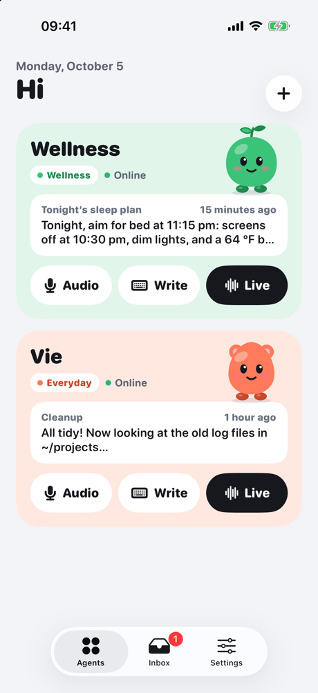
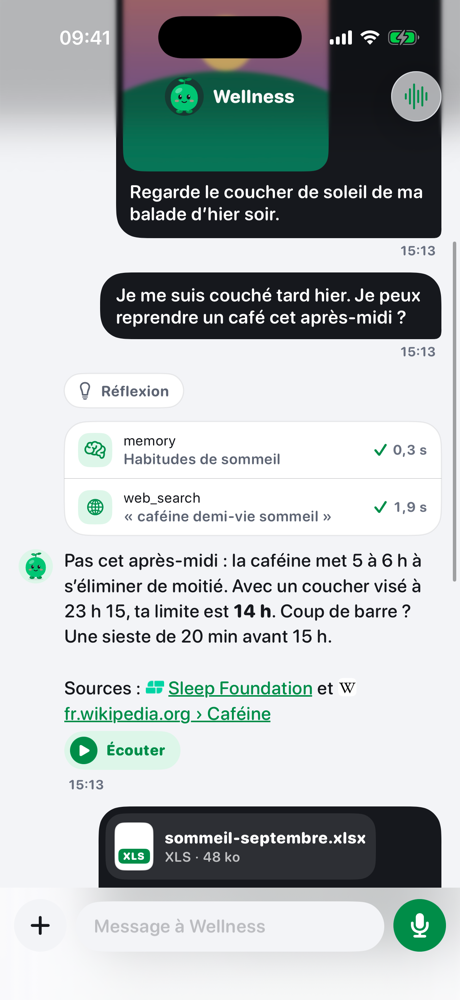
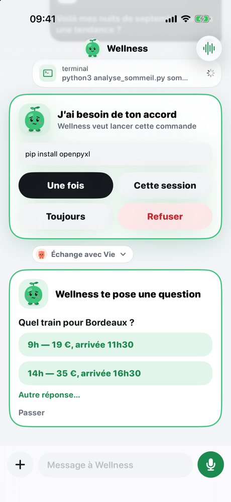
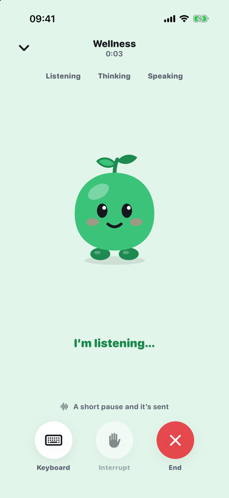
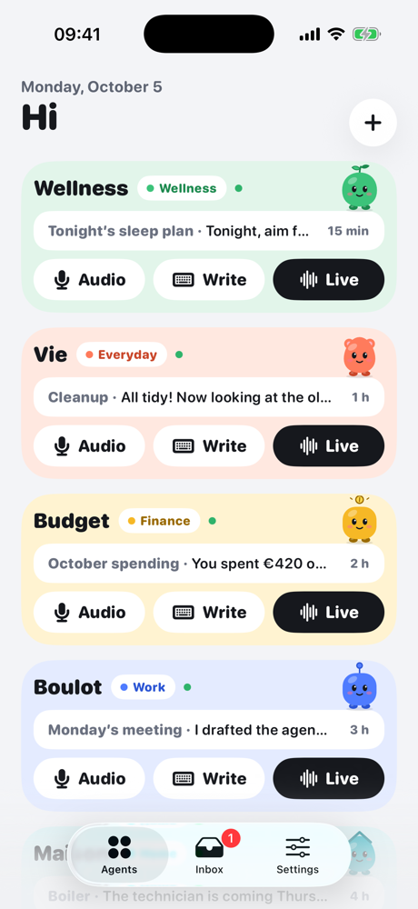
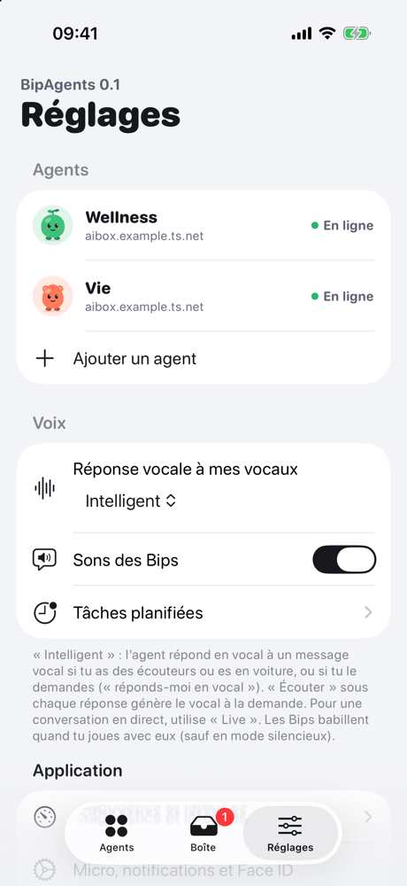
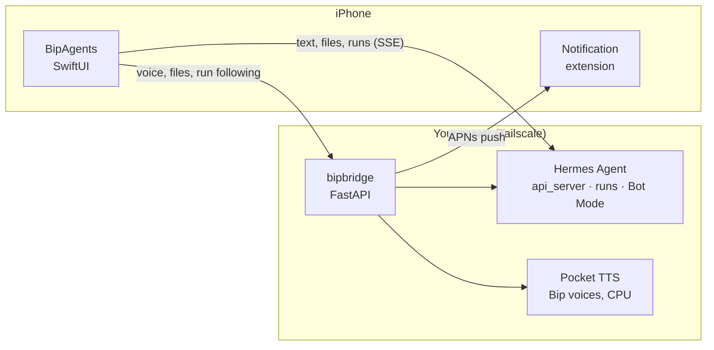

<p align="center">🇬🇧 English · <a href="README.fr.md">🇫🇷 Français</a></p>

<p align="center">
  
</p>

<h1 align="center">BipAgents</h1>

<p align="center">
  <b>Talk to your self-hosted AI agents like they're pocket-sized buddies.</b><br>
  A voice-first iOS app for <a href="https://github.com/NousResearch/hermes-agent">Hermes Agent</a>, running on your own server, over Tailscale.
</p>

<p align="center">
  <a href="https://alexbob0.github.io/BipAgents/play/"></a>
  <a href="https://x.com/Bob_AI_Digger"></a>
  
  
  <a href="LICENSE"></a>
</p>

---

Every agent is a **Bip**: a little mascot with its own color, shape, mood and **voice**. Wellness looks after your sleep, Vie tidies your files, Budget keeps an eye on your spending… Text them, talk to them, or start a **Live** to chat out loud, hands-free. They work on **your** server, and the app lets you know when they're done, or when they need you.

<p align="center">
  
  
  
  
</p>

## 🚀 Get started in 4 steps

1. **📱 On your iPhone**: install **BipAgents** from the App Store *(coming soon)* and
   [**Tailscale**](https://tailscale.com/download), then sign in to Tailscale.
2. **🖥️ Pick a machine that stays on**, where your agents will live: a Mac or a Linux PC at home, or a
   [small rented server](docs/vps.md) from ≈ €8 a month. No GPU needed. Install Tailscale on it too, with the same
   account.
3. **⌨️ Paste this into its terminal**, then answer a few questions (your agents' names, and which model they use: one
   on your network, or an OpenRouter key):

   ```bash
   curl -fsSL https://raw.githubusercontent.com/Alexbob0/BipAgents/main/install.sh | bash
   ```

4. **📷 Scan the QR code** it shows at the end: in the app, **＋ › Scan QR code**. Your Bips say hello. 👋

Later: `bipagents update` keeps everything up to date, `bipagents family add <name>` makes room for someone else, and
`bipagents console` opens your agents in a computer's browser.

## 🎮 Play with the Bips

The Bips aren't just decoration. In the app (and [**in your browser**](https://alexbob0.github.io/BipAgents/play/)), they react:

| Gesture | Reaction |
|---|---|
| 👆 Tap | a little hop, a wink, a twirl… at random |
| 👆👆👆 Three quick taps, or a fast rub | that tickles! |
| 🫳 Slow stroke | purring, hearts, rosy cheeks |
| ✊ Long press, then let go | **Boing!** |
| 😵 Pester them too much | they get dizzy… then sulk |

And they **babble**: every reaction is spoken in their "Animalese", cute gibberish synthesized on the fly, with no model and no network, and a pitch of its own for each Bip.

<p align="center">
  <a href="https://alexbob0.github.io/BipAgents/play/"><b>→ Open the Bips playground</b></a>
</p>

## ✨ What the app does

- 🎙️ **Voice first**: voice notes (hold "Audio" on an agent's card, let go, done), hands-free **Live** you can interrupt just by talking, and "Listen" under every reply, streamed.
- 🗣️ **A voice per Bip**: cute Kyutai Pocket TTS voices, **on CPU, no GPU** (≈ 50 ms to first audio on an M4 Mac mini), designed natively in English, French, Spanish and German. Numbers, symbols, abbreviations and brand names are made speakable in each language. Got a GPU? Plug in **your own voice model** (Fish Audio Drama 3, Kokoro, Kyutai 1.6B…) for the Live, spoken replies or reading messages; the Bip takes over when it's slow or down.
- 🖥️ **Each agent's own visible browser**, live on your phone: full screen, landscape, pinch to zoom, take over to log in (the agent waits), and a **vault** that fills passwords without the agent ever seeing them.
- 👨‍👩‍👧 **The whole family**: one install per person on the same server, each in their own account; agents can write to each other (even across households) only along links the person turned on, and share folders read-only.
- 🔒 **Keeps going on the lock screen**: messages are sent as Hermes *runs*. Close the app, the agent finishes its work, and the reply shows up as a notification, with the Bip's avatar and the actual text.
- ✅ **Approvals from the lock screen**: "Wellness wants to run `pip install openpyxl`" → Once / This session / Deny, without opening the app.
- ❓ **The agent can ask you a question** (`clarify` tool): a card with one button per choice, like Hermes Desktop.
- 🤝 **Agents talk to each other**: Vie can consult Wellness; the exchange folds into a single line in the conversation.
- 📬 **The Inbox**: scheduled-task (cron) reports and replies that arrived while you were away, to listen to or pick up in Live.
- 📎 **Any kind of file**: photos, PDFs, spreadsheets, scans… and files the agent produces (audio, documents) open right in the app.
- 🌍 **In English, French, Spanish and German**: the app follows the iPhone's language, and each agent has its own (speech recognition and voice).
- 💻 **On your computer too**: `bipagents console` gives a link that opens your agents, their conversations and the Inbox in a browser, no Hermes key ever reaching it.
- 🔗 Clickable links with favicons, folded tool calls, drafts kept per conversation, day separators.

<details>
<summary><b>📸 More screenshots</b></summary>
<br>
<p align="center">
  
  
  
</p>
</details>

## ☁️ Your own agent on a small server, from €8 a month

No machine at home? A **small VPS** runs Hermes, the bridge and the Bips' voices on its CPU (2 vCPU and 4 GB from
≈ €8 a month; 4 vCPU and 8 GB, with each agent's visible browser, ≈ €15), and the model comes from **OpenRouter**, paid
as you use it. You get an agent that's always on, in your pocket, with a voice.

- **What stays yours**: the conversations, the agents' memory, your files and the vault live on your server, not on a
  platform's. Switch models whenever you want; nothing to export.
- **What leaves**: each message goes to the model you chose, to be answered. Pick providers that keep nothing in
  OpenRouter's privacy settings (zero data retention), or a model running at home, reached through Tailscale.
- **What you don't do**: open ports. Everything goes through Tailscale; even SSH can be closed.

Step by step, from a prepared cloud-init to the QR code: [**BipAgents on a rented server**](docs/vps.md).

## 🧩 How it works



- **The app** talks straight to the Hermes api_server (sessions, runs, approvals, questions) and to the **bridge** for everything else.
- **The bridge** (`bridge/`, Python) prepares and synthesizes speech, serves files, relays runs so no event gets lost, watches scheduled tasks and sends push notifications.
- **Pocket TTS** (`pocket/`) gives the Bips their voices, on the same machine's CPU.
- Everything stays with you: no third-party cloud except Apple for push. No secrets in this repo; keys are entered in the app (Keychain) or in the bridge config on the server.

## 🛠️ More about installing

**Just to have a look**, no server needed: open `BipAgents.xcodeproj`, BipAgents scheme → Arguments → `-demo`. Add `-screen conversation`, `-screen call`, `-tab inbox` or `-demoAgents 5` to land straight on a screen.

**For real**: a **Mac mini**, a **VPS** or a Linux box is enough, no GPU; [Hermes Agent](https://github.com/NousResearch/hermes-agent) comes with the installer if you don't have it. Doing it by hand instead: [**Self-hosting BipAgents**](docs/self-hosting.md). No machine at home: [**BipAgents on a rented server**](docs/vps.md).

**The install command** (step 3) runs in your own account, no sudo. It finds or installs Hermes (or keeps yours as it is), looks for a model on your network or takes an API key, sets up
the bridge, the Bips' voices, each agent's visible browser and sandbox (podman), publishes everything on your tailnet
and ends with a QR code to scan in the app. **One command to update**: `bipagents update` restarts only what changed,
applies the new settings, offers to update the family's other installs with a single sudo, and can do it every night
([details](installer/README.md#updating-bipagents)).

**A whole household on one server**: one install per person, each in their own account, prepared by the administrator with `bipagents family add <name>` — [who runs what, from which account](installer/README.md#several-people-on-one-machine).

> 🎙️ **Bonus**: with a GPU, your own voice model (Fish Audio Drama 3, Kokoro, Kyutai…) can speak instead of the Bips for the Live, spoken replies or reading messages. Optional, see the end of the guide.

## 🧱 What BipAgents adds to Hermes

[Hermes Agent](https://github.com/NousResearch/hermes-agent) does the thinking: models, tools, memory, skills, routines.
BipAgents makes it something you carry around and share at home:

| | Hermes alone | With BipAgents |
|---|---|---|
| Talking to it | terminal, chat platforms, web UI | a voice-first iPhone app: voice notes, hands-free Live, listen to any reply |
| Voices | none | a voice per agent on CPU (4 languages), or your own model on a GPU |
| Away from the app | | push notifications with the reply, approvals and questions from the lock screen |
| Installing | Hermes' installer, then config by hand | one command: Hermes, bridge, voices, browsers, sandboxes, Tailscale, QR code |
| Updating | `hermes update` | `bipagents update`: what changed, the family's installs with one sudo, nightly |
| Browsing | a browser tool | each agent's own Chrome, watched and taken over from the phone, with a vault |
| Several agents | profiles | a mascot, a voice and settings per agent; agents in their own space when they hold secrets |
| Several people | | one isolated install per person on the same server; households linked on purpose |
| Prompt injection | approvals | approvals always asked, agents told that what they read is data, peers limited to a chat, the agent paused while you hold its browser |

## 🩹 Hermes patches still needed

A few changes BipAgents needs aren't in Hermes yet. The installer applies them (and `bipagents hermes-update` checks
them before updating Hermes); each one is offered upstream. Details in [`hermes/patches/`](hermes/patches/README.md).

| Patch | Why | Upstream |
|---|---|---|
| 0001 `clarify` in the Runs API | the agent can ask you a question with choices from the app | offered to #116259 |
| 0004 images kept in the conversation | a follow-up question about a photo still sees the photo | replaced by #139873 (open) |
| 0005 vault fills after the browser restarted | logins keep working when the agent's browser was closed and reopened | #136660 |
| 0006 a peer's reply comes back to the app | when an agent asks another one, its answer reaches your conversation | local |

<details>
<summary><b>🗂️ The repo</b></summary>

- `App/` — the SwiftUI app (iOS 18+, Swift 6).
  - `Design/` — theme, categories, vector mascots (`MascotView`), interactions (`InteractiveMascot`), babbling (`BipBabble`), agent voices.
  - `Model/` — `AgentStore` (agents in the App Group, keys in the Keychain), `BridgeClient`, `Router`.
  - `Features/` — Agents, Sessions, Conversation, Live, Inbox, Settings, Diagnostics, notifications.
  - `Resources/` — string catalogs (English, French, Spanish, German) and voice previews.
- `NotificationService/` — extension that puts the full text, the Bip's avatar and the audio into notifications.
- `Packages/HermesKit` — Hermes api_server client (SSE, sessions, runs, approvals, `clarify`, attachments).
- `Packages/VoiceKit` — capture, on-device transcription, streamed PCM TTS, voice barge-in.
- `bridge/` — the server-side Python service ([README](bridge/README.md)).
- `pocket/` — the Pocket TTS server for the Bips' voices ([README](pocket/README.md)).
- `voices/` — the Bips' voices ([README](voices/README.md)).
- `installer/` — the installer and `bipagents update` ([README](installer/README.md)); `browser/` — the agents' visible browser ([README](browser/README.md)); `hermes/patches/` — the Hermes patches ([README](hermes/patches/README.md)); `tts/drama3/` — a recipe for Fish Audio Drama 3 as your own voice model.
- `docs/` — API notes ([`clarify`](docs/hermes-clarify-api.md), [files](docs/file-uploads.md)), screenshots, [playground](docs/play/index.html) and banner (`node docs/tools/banner.mjs` rebuilds it).

</details>

## 💬 Who's behind it

A personal project by **Bob**, who digs into AI every day: agents, voices, self-hosting.
Behind the scenes, the struggles and the next Bips are on X: **[@Bob_AI_Digger](https://x.com/Bob_AI_Digger)** 👋

Built with [Hermes Agent](https://github.com/NousResearch/hermes-agent) by Nous Research, [Kyutai](https://kyutai.org)'s voices, and many sessions with Claude.

<p align="center"><sub>MIT · Made with ♥ and Bips</sub></p>
